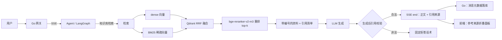

# 智能客服 Agent 技术实践：检索优化与答案溯源

> 本文按两条主线展开：如何把知识库检索做准，以及如何让回答可溯源、在资料不足时敢于拒答。
> 内容以技术选型、实现方式、实测结果和工程取舍为主，不展开完整原理推导。

---

## 1. 项目定位

一个电商智能客服 Agent，核心能力是**基于企业知识库回答问题，并在资料不足时拒答**。

| 项 | 内容 |
|---|---|
| 技术栈 | Python（FastAPI + LangGraph + LangChain）、Go（网关 / SSE / 落库）、PostgreSQL、Qdrant、Redis |
| 检索链路 | dense embedding + BM25 稀疏检索 + RRF 融合 + bge-reranker-v2-m3 重排 |
| 幻觉治理 | 检索结果编号化 + 提示词强制引用 + 生成后校验 + 固定拒答话术 + 前端可查 |
| 我的职责 | 检索链路设计与实现、离线评测体系、引用治理闭环、Agent → Go → 前端的透传与落库 |
| 项目规模 | 8 篇业务知识库、100 条冻结评测集（85 条有答案 / 15 条无答案）、3 种检索模式对比 |

两条主线是一条因果链，不是两个孤立需求：

```text
检索优化发现：Recall@3 已 100%，瓶颈在"排序"和"chunk 粒度"
        ↓
检索优化做：混合检索 + 重排，把 Top-1 从 0.953 提到 0.988
        ↓
检索优化还发现：dense/hybrid 下有答案与无答案的分数分布重叠
        ↓
答案溯源做：编号引用 + 程序侧硬校验 + 固定拒答，补上"生成后"这道闸门
```

---

## 2. 总体数据流



关键点：检索结果同时走两条路——**给模型的是带编号的文本**，**给程序的是结构化的引用清单**。模型只能"引用"，不能"发明"来源。

---

## 3. 检索优化

### 3.1 先定基线，再谈优化

用 100 条真实业务问题做冻结评测集（覆盖 8 篇政策文档），分三类：高频 47、长尾 35、多跳 3；其中 15 条是知识库确实答不出的"无答案"题。

基线（仅稠密向量检索，k=3）实测：

| 指标 | 数值 | 说明 |
|---|---|---|
| Recall@1 | 0.953 | 第一名是否命中期望文档 |
| Recall@3 | 1.000 | 前三名是否覆盖 |
| MRR | 0.975 | 首次命中的排名倒数 |
| Evidence hit@3 | 0.988 | 文本块（chunk）内容是否真的包含答案关键词 |

**结论先行**：Recall@3、Recall@5 已饱和，说明"召回"不是瓶颈；真正的问题是 **Top-1 排序**和 **chunk 级证据命中**。因此后续只主攻两件事：混合检索（改善排序）和 cross-encoder 重排（精排），没有继续堆召回。

### 3.2 索引侧：标题感知分片

| 做法 | 原因 |
|---|---|
| 先按 Markdown 的 `#` / `##` 标题切段 | 保留"文档标题 / 小节标题"结构 |
| 再切 200 字、重叠 30 字 | 客服政策是短事实，chunk 太大引入噪声 |
| 每个 chunk 前置 `[文档标题 > 小节标题]` | 让向量检索和 BM25 都带上结构信息，缓解跨文档边界混淆 |
| 只有标题没有正文的段直接丢弃 | 避免纯标题垃圾分片 |

### 3.3 检索侧：dense + BM25 + RRF

- **dense**：走租户配置的 Embedding 服务，负责语义泛化（"退款多久到账" ↔ "3-7 个工作日"）。
- **sparse**：使用本地 CPU 的 BM25 模型，纯统计、无需额外模型服务。
- **中文关键处理**：BM25 自带分词器会把无空格中文当成一个 token，所以索引和查询前统一用 **jieba 分词再空格拼接**；两边必须一致，否则 token 对不上。
- **融合**：Qdrant 的命名向量 + RRF（Reciprocal Rank Fusion），两路各取 20 个候选，融合后取 top-k。选 RRF 而不是加权分数，是因为 dense 的 cosine 与 BM25 的量纲不可比，RRF 只看排名，不需要额外调归一化参数。

### 3.4 精排：bge-reranker-v2-m3

| 决策 | 具体做法 | 理由 |
|---|---|---|
| 模型 | `BAAI/bge-reranker-v2-m3` cross-encoder | 中文客服语料上比双塔召回更擅长"问题—段落"细粒度匹配 |
| 候选池 | 只重排混合检索的 **top-5** | cross-encoder 是 O(N) 推理；CPU 单条前向 3~5 秒，10 候选会到 30~50 秒，顶穿网关超时 |
| 并发 | 推理放到线程池执行 | 避免 CPU 推理阻塞异步事件循环 |
| 降级 | 模型加载失败时自动退回不重排 | 检索可用性优先，不能因为重排故障导致整条链路不可用 |
| 部署 | 镜像构建期预下载模型 | 运行时不依赖外部模型下载 |

**一个重要认知**：重排只能重排已有候选，不能提升召回上限。因此它是"叠在混合检索之上"，不是"替代混合检索"。

### 3.5 三种模式实测对比（同一套 100 条、k=3）

| 配置 | Recall@1 | MRR | Evidence hit@3 | 结论 |
|---|---:|---:|---:|---|
| 仅稠密检索 | 0.953 | 0.975 | 0.988 | 语义基线 |
| 混合检索（dense + BM25 + RRF） | 0.941 | 0.971 | **1.000** | 文档级 Top-1 略降，但 chunk 级证据命中补满 |
| 混合检索 + 重排 | **0.988** | **0.994** | **1.000** | 生产推荐配置 |

怎么读这组数：

- 混合检索的文档级 Recall@1 反而降了 0.012，但 Evidence hit@3 从 0.988 到 1.000——说明 BM25 把"关键词精确"的段落拉进来了，只是文档标题排序被稀释；**这正是需要重排的信号**。
- 重排把 Top-1 未命中从 5 条压到 1 条（只剩一条多跳题），MRR 从 0.971 提升到 0.994。
- **不夸大提升**：8 篇语料的 Recall@3/@5 天然饱和，这组数字只能说明"排序有效"，不能外推到大语料。这个边界需要在结论里主动说明。

数据来自留档的评测报告，可用同一套冻结评测集复现。

### 3.6 评测体系

不是"跑几条看看"，而是一套可复现的离线评测：

- 评测集每条带期望文档、必须包含的关键词、证据关键词和参考答案；
- 双粒度指标：文档级 Recall@k / MRR，chunk 级 Evidence hit@k；
- 额外输出：Top-1 分数分布、阈值扫描（准确率 / 误拒率 / 泄漏率）；
- 全流程脚本化：一键重置知识库并等待索引完成；评测脚本支持三种检索模式、可指定 k 和指定用例。

**这套评测体系直接产出了"答案溯源"的立项依据**——阈值扫描发现：

| 检索模式 | 有答案 Top-1 最低分 | 无答案 Top-1 最高分 | 结论 |
|---|---:|---:|---|
| 仅稠密检索 | 0.497 | 0.650 | 分布重叠，任何阈值都在"误拒 ↔ 泄漏"之间交换 |
| 混合检索 | 0.583 | 1.000 | 重叠更严重，阈值几乎不可用 |
| 混合检索 + 重排 | -0.667 | -1.140 | 完全可分：最优阈值落在负区间（约 -1.1 ~ -0.7）；扫描从 0 起时误拒 4.7%、泄漏 0% |

dense/hybrid 下阈值不可用；重排后阈值虽然可分，但它依赖具体模型版本、需要逐版标定，而且"分数高"不等于"回答 grounded"。因此没有把阈值当主力拒答手段，只把它当低分兜底，主力放到生成后的引用校验。

### 3.7 生产接入的两个工程细节

1. **保留真实检索分数**：上层检索封装只返回文档内容、会丢掉相似度分数，无法做阈值过滤和效果分析。因此知识库检索工具直接调用底层检索接口，保留分数并写入检索命中记录表，形成"检索命中 → 业务反馈"的数据闭环。
2. **检索失败降级**：Embedding 服务不可用时不把异常抛给对话链路，而是返回"知识库暂未就绪"，让模型如实告知用户，而不是编造。

---

## 4. 答案溯源与拒答

### 4.1 要解决的不是"模型笨"，是"没法验证"

检索增强生成（RAG）的幻觉分三类：

| 类型 | 成因 | 归属 |
|---|---|---|
| 检索未召回 | 正确段落没进 top-k | 检索优化解决 |
| 生成未 grounded | 段落进了提示词，模型没用或理解错 | 答案溯源主力 |
| 引用幻觉 | 模型编造不存在的编号，或引用了不属于本题的 chunk | 答案溯源主力 |

业务上最危险的是**可量化事实**（金额、时效、比例、责任主体）：说错"运费平台承担"就是真金白银的赔付。因此目标不是"消除所有幻觉"，而是：**可量化事实必须可溯源；资料不足必须敢拒答。**

### 4.2 三个机制，一条闭环

#### 机制一：把 grounding 从"软承诺"变成"编号硬契约"

知识库检索不再返回纯文本，而是返回 `[n]` 编号文本；同时程序侧保存一份"编号 → 原文片段"的引用清单：

| 字段 | 作用 |
|---|---|
| 编号 | 回答中可引用的唯一 ID |
| 文档 ID / 标题 / 小节 | 支持反查原文与展示来源 |
| 摘要片段 | 前端展示的原文摘录 |
| 检索分数 | 便于排查"为什么引用了这条" |

细节：

- 多次调用检索时**编号连续递增**，不会每次都从 1 开始；
- 同一文档、同一片段重复命中会去重，保留第一次编号；
- 引用清单保存在**请求级上下文**，而不是进程级全局变量，保证并发请求之间不串数据；
- 每次请求入口显式清空，避免上一轮污染下一轮。

#### 机制二：提示词强制引用（但知道它不可靠）

系统提示词里写死四条：只能依据检索资料回答；每条结论后标 `[n]`；资料不足必须说"没查到"；金额、时效、比例必须紧跟引用编号。

但**提示词是行为约束，不是行为保证**。模型可能漏标，也可能编造不存在的编号。因此必须有机制三。

#### 机制三：生成后程序侧硬校验

回答生成完成后，程序提取回答中的所有引用编号，与本次检索产生的合法编号集合比对：

| 校验规则 | 处理 |
|---|---|
| 回答为空 | 替换为拒答话术 |
| 本次没有检索（寒暄、订单查询等） | 放行，不要求引用 |
| 有检索结果，但回答里没有任何引用编号 | 视为无依据回答，替换为拒答话术 |
| 回答引用了不存在的编号 | 视为编造来源，替换为拒答话术 |
| 所有引用编号都合法 | 放行 |

三个关键设计：

1. **只做"必要条件"校验**：保证编号真实存在，不保证"编号对应的段落真的支持这句话"。后者需要 claim 级语义判断，成本高，留给离线评测。先用零成本、确定性 100% 的正则校验挡住最危险的"编造来源"。
2. **拒答话术固定模板**，不让模型生成拒答。否则"拒答"本身又会成为新的幻觉来源。
3. **无检索时放行**：寒暄、订单查询、转人工不走知识库，不能因为没引用就误拒。

### 4.3 三层拒答策略：为什么选"阈值兜底 + 引用校验主力"

| 策略 | 位置 | 机制 | 成本 | 主要风险 | 本项目 |
|---|---|---|---|---|---|
| 前置意图闸门 | 检索前 | 首条检索分数低于阈值直接拒，不调用模型 | 低 | 分布重叠导致误拒高 | **未落地**（论证后放弃） |
| 检索阈值兜底 | 检索后 | Top-1 分数低于阈值 → 拒答 | 零 | 分布重叠，漏网高 | 已上线，默认阈值 0，只兜极端低分；重排模式下应标定到负区间 |
| 生成后引用校验 | 生成后 | 引用编号必须属于合法集合 | 低 | 不校验 claim 语义 | **主力，默认开启** |

为什么前置闸门没落地：它只能拿到稠密检索分数，而实测证明稠密检索下有答案与无答案的分数高度重叠；再在前面加一道同分布的阈值闸门，只会把误拒率推高，收益不确定。这是**验证过但主动不做**的决策。

### 4.4 流式场景怎么处理校验失败

这是最容易踩坑的地方：token 已经推给用户了，撤回不了。

实际实现：

1. 流式期间逐 token 推送，用户实时看到内容；
2. 结束事件携带**校验后的完整正文**和引用来源；
3. 前端收到结束事件后，用最终正文**覆盖气泡文本**；
4. 如果校验失败，最终正文就是固定拒答话术——用户看到回答被替换，而不是看到一段错误承诺留在屏幕上。

代价是"拒答时内容会闪变"，但比"错误承诺已经展示出去"风险低得多。

### 4.5 跨语言透传：Agent → Go → 数据库 → 前端

| 环节 | 具体做法 |
|---|---|
| Agent 输出 | 流式结束事件携带引用来源列表；普通内容块不带 |
| Go 解析 | 用统一结构接住引用列表，在流式结束回调中透传 |
| 落库 | 引用列表序列化后存入消息记录的元数据字段；空列表存空串，避免空数组污染历史 |
| 前端 | 渲染"参考来源（n）"折叠面板，展示 `[n] 标题 · 小节 · 分数 · 摘要` |

这一步的价值不只是"好看"：**线上出问题时，可以从一条回答直接反查到当时引用了哪篇文档、哪个小节、分数多少。**

### 4.6 验收口径与当前状态

| 指标 | 目标 | 怎么测 | 当前状态 |
|---|---|---|---|
| 无答案拒答率 | ≥ 90%（15 条里最多 1 条泄漏） | 用 15 条无答案题做端到端测试 | 机制已上线（引用校验默认开启）；回答级评测脚本待补 |
| 有答案引用覆盖率 | 100% | 抽样 20 条，检查每条结论是否有合法引用 | 同上 |
| 误拒率 | ≤ 5% | 85 条有答案题被拒比例 | 同上 |
| 前端可查 | 点开能看到原文片段 | 手动验证 | 已完成 |
| 不引入回退 | 有答案准确率不明显下降 | 对比基线答案命中率 | 待回归 |

这里不做夸大：**检索指标有完整报告可复现；溯源机制已上线、验收口径已定义，但回答级全量回归还没跑完**。机制上线和指标达标是两件事，需要分开说明。

---

## 5. 关键取舍与踩坑

| 问题 | 选择 | 原因 |
|---|---|---|
| 为什么用 RRF 不用加权分数融合 | RRF 只看排名 | dense cosine 与 BM25 分数量纲不可比，加权还要调参；RRF 无参数、更稳 |
| 单路检索怎么保留可解释分数 | 单路不做融合，保留原始相似度 | 套融合后第一名分数恒为 0.5，阈值标定和分数分析会失效 |
| 为什么 BM25 前要中文分词 | 索引和查询都做 jieba 分词 | 中文无空格，原生分词器会把整句当一个 token |
| 为什么重排只取 top-5 | 候选 5，不取 10 | CPU 单条推理 3~5 秒，10 候选会到 30~50 秒并顶穿网关超时 |
| 为什么重排放线程池 | 同步推理异步化 | 否则阻塞事件循环，所有并发请求一起卡住 |
| 为什么直接调底层检索接口 | 保留相似度分数 | 上层封装会丢分数，无法落库和阈值过滤 |
| 为什么引用校验用正则不用大模型 | 正则做必要条件 | 零成本、确定性 100%；语义校验留给离线 judge，不拖线上延迟 |
| 为什么拒答话术不让模型生成 | 固定模板 | 让模型生成拒答，拒答本身可能继续幻觉 |
| 为什么引用清单用请求级上下文 | 避免并发串数据 | 进程级全局变量会跨请求污染；入口统一清空 |
| 为什么没有引用时放行 | 避免误拒寒暄、订单、转人工 | 代价是纯闲聊场景没有引用保护，靠提示词和业务分流兜住 |
| 流式校验失败怎么办 | 结束事件覆盖气泡 | 已推送内容无法撤回；用最终正文覆盖，风险最低 |

还有一个运维层面的坑：**提示词可能同时存在默认配置和数据库配置，线上通常以数据库为准**。只改默认配置而不更新线上配置，会出现"代码改了但行为没变"的假修复。这类问题在 RAG 项目里很常见，需要用配置核对和回归测试兜住。

---

## 6. 常见问题与补充说明

**Q1：8 篇文档的 Recall@3 当然是 100%，指标有意义吗？**
所以我只看 Recall@1、MRR、Evidence hit@3，并明确说明语料小、指标饱和。结论只用于证明"排序有效"，不代表通用检索能力；真正可复用的是评测方法和"混合检索 → 重排"的链路设计。

**Q2：为什么不继续做 query 改写、多路召回？**
基线 Recall@3 已 100%，再堆召回没有收益，瓶颈在 Top-1。先把收益最大的排序做好，符合"优化对准最弱环节"。

**Q3：引用校验只保证编号存在，不保证内容支持结论，有什么用？**
它挡的是最危险、最高频的"编造来源"和"有资料却完全不用"。语义级校验（claim 是否被 chunk 支持）成本高，放在离线 LLM-as-judge 和人工抽检，线上不做。

**Q4：拒答率 90% 会不会误拒太多？**
因此必须同时看误拒率 ≤5%。两个指标是一对约束，不能只看一个。检索分数分布就是用来标定这个边界的。

**Q5：流式已经推出去了，校验失败用户不是看到了错误内容？**
会短暂看到，但结束事件到达时会被完整拒答话术覆盖。另一种方案是"拼完再推"，代价是首字延迟增加数百毫秒；选了覆盖方案，因为错误承诺留在屏幕上的业务风险更高。

**Q6：如果知识库从 8 篇涨到 1 万篇，这套还成立吗？**
索引侧要加分片并发、增量索引、collection 分片；检索侧要扩大候选池并调优 ANN 参数；重排的 CPU 成本会成为瓶颈，需要 GPU 或小模型蒸馏；评测集要扩到千级并做分层抽样。当前架构的接口（命名向量、RRF、重排可插拔）能承接，但参数和部署要重做。

**Q7：这项工作的核心价值是什么？**
把"防幻觉"从"改提示词"拆成**可分解、可验证、可量化的工程问题**：检索侧有指标、生成侧有硬校验、链路上有落库和前端可查。这样后续换模型、改提示词、调检索参数，都不会悄无声息地把幻觉带回来。

---

## 7. 一页速记

```text
检索优化：
  dense + BM25(jieba) + RRF → bge-reranker-v2-m3 → top3
  100 条评测：dense R@1 .953 / hybrid .941 / rerank .988
  关键结论：召回已饱和，瓶颈在排序；dense/hybrid 阈值不可单独拒答

答案溯源：
  检索结果编号化 + 请求级引用清单
  提示词强制引用（软约束）
  生成后校验引用编号（硬闸门）
  非法 → 固定拒答话术
  结束事件下发引用 → 元数据落库 → 前端参考来源

为什么：编号机制把 grounding 从"模型软承诺"变成"硬契约"
代价：正则只做必要条件；语义校验留离线；流式拒答会闪变
```
